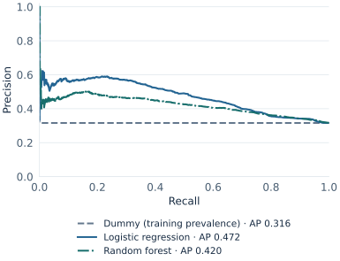

# Bank Marketing Conversion Prediction

An analyst on a bank’s outreach team needs to decide which eligible customers to call when the team can contact only a fraction of its list. This project tests whether information available before the current call can rank likely term-deposit subscribers better than selecting candidates at random.

The analysis uses the original **UCI Bank Marketing** dataset, `bank-full.csv`. Its 45,211 examples describe phone campaigns at a Portuguese bank. The label, `y`, records whether a customer subscribed to a term deposit. See the data card for the exact file, citation, license, dictionary, and feature availability. [Data card](DATASET.md) · [UCI dataset](https://archive.ics.uci.edu/dataset/222/bank+marketing)

## Results

**The random forest ranked historical subscriptions above the prior-only baseline. Its frozen cutoff exceeded the call budget on the later cohort.** At an enforced 20% budget, the top-ranked 1,808 holdout records included 841 observed subscriptions versus about 571 expected under random ranking.

| Model | Validation AP | Holdout AP | Holdout ROC-AUC | Holdout Brier |
| --- | ---: | ---: | ---: | ---: |
| Prior-only dummy | 0.118 | 0.316 | 0.500 | 0.287 |
| Logistic regression | 0.180 | 0.472 | 0.662 | 0.278 |
| Random forest | 0.190 | 0.420 | 0.631 | 0.282 |

Validation average precision selected random forest. Logistic regression had better ranking and probability scores on the holdout. Keep the validation choice in the reported outreach comparison and test both candidates on a new cohort before adoption. The holdout subscription rate was 31.58%. All three models selected zero rows at the common 0.50 cutoff. Their precision, recall, and F1 are reported as zero at that cutoff, with precision undefined when nothing is selected.



The strict validation cutoff, score > 0.06144690 (rounded here), selected 1,808 validation records (20.00%). On the holdout, it selected 2,486 records (27.49%), with precision 45.05%, recall 39.22%, and F1 0.419. It found 1,120 of 2,856 observed subscriptions. The confusion matrix records 4,821 true negatives, 1,366 false positives, 1,736 false negatives, and 1,120 true positives. The reliability plot shows substantial holdout underprediction. Treat the scores as rankings until calibration is checked on recent data. [Calibration](reports/figures/calibration.svg) · [Confusion matrix](reports/figures/confusion-matrix.svg)

| Holdout budget | Records selected | Observed subscriptions | Expected random subscriptions | Precision | Recall |
| --- | ---: | ---: | ---: | ---: | ---: |
| 10% | 904 | 450 | 286 | 49.78% | 15.76% |
| 20% | 1,808 | 841 | 571 | 46.52% | 29.45% |
| 30% | 2,712 | 1,199 | 857 | 44.21% | 41.98% |

The budget comparison uses historical outcomes among the selected rows. It supports a capacity-limited ranking pilot. Estimating subscriptions caused by contact requires a randomized comparison. [Budget chart](reports/figures/contact-budget.svg)

## Run the project

From a checkout of this repository, use Python 3.12. The first run downloads the official UCI ZIP and verifies it before caching it. It requires internet access and no credentials. The next run can use the cache.

```sh
cd projects/bank-marketing
python3.12 -m venv .venv
. .venv/bin/activate
python -m pip install -r requirements.txt
python -m src.run
python -m unittest discover -s tests -v
```

Use `--raw-dir` to point to a different download cache or `--reports-dir` to write a separate set of outputs. For a manual download, save the [official ZIP](https://archive.ics.uci.edu/static/public/222/bank+marketing.zip) at `data/raw/bank-marketing.zip` and run the same command. The run writes aggregate reports and figures. Downloaded data stays in the ignored `data/` directory.

| Output | Contents |
| --- | --- |
| [metrics.json](reports/metrics.json) | Data provenance, split sizes and rates, model metrics, calibration bins, and outreach scenarios |
| [eda.json](reports/eda.json) | Completeness, duplicate counts, encoded unknowns, training distributions, and base rates over time |
| [model-comparison.csv](reports/model-comparison.csv) | Validation and test model scores at the common 0.50 cutoff |
| [figures/](reports/figures/) | Generated cohort, precision–recall, calibration, budget, and confusion-matrix charts |

To refresh the portfolio figures after rerunning, copy `reports/figures/*.svg` into `../../docs/assets/bank-marketing/` and update the case study’s tables and narrative from the new reports. The published portfolio serves offline-generated HTML and SVGs as static files under `/Projects/`. Serve the `docs/` tree at that prefix during local review.

## Method

1. **Validate the source.** Verify the archive and exact schema, check category and numeric values, map `no` to 0 and `yes` to 1, and keep the file’s original date order. EDA summarizes missingness and literal `unknown` values separately and inspects the prevalence change across chronological blocks.
2. **Enforce scoring-time availability.** Allow bank profile fields and prior-campaign outcomes. Convert the `pdays = -1` sentinel to a prior-contact flag plus a missing elapsed-days value. Preserve categorical `unknown` as an explicit category. Exclude `duration`, current-campaign contact count `campaign`, and current contact type and calendar fields. Leave age and marital status outside training.
3. **Separate time blocks.** Use the earliest 60% for training, the next 20% for model and cutoff selection, and the last 20% for final evaluation. Fit imputation, encoding, scaling, and estimators on training rows. The held-out block is never used to select a model or cutoff.
4. **Compare models.** Fit a prior-only dummy classifier, logistic regression, and a seeded random forest. Select by validation average precision, the non-interpolated summary of the precision–recall curve. Use ROC-AUC, average precision, Brier score and reliability bins to assess ranking and probabilities, and precision, recall, F1 and confusion matrices to assess decisions at specified cutoffs.
5. **Simulate outreach budgets.** Freeze a validation cutoff selected to stay within 20% capacity. Measure its actual contact volume and class outcomes on the holdout. Evaluate separate fixed-size ranking scenarios at 10%, 20%, and 30%, alongside expected random-selection totals at the same budget. Use original row order as a deterministic tie-breaker for rank-based retrospective analysis.

## Limits and next steps

The evaluation measures ranking among customers who were contacted in historical campaigns. It does not measure incremental subscriptions caused by calling. The dataset has no unique customer IDs, full row timestamps, untreated control group, contact cost, deposit value, or modern deployment data. Chronological evaluation preserves the direction of time. Repeat customers may appear across blocks. Rows near a split boundary may also share a contact date.

Population, contact practices, and subscription rates can change. Check feature availability and campaign rates on a fresh cohort before using the ranking. Excluding age and marital status does not remove bias in selection, observed outcomes, or proxy features such as job and education. Check consent and eligibility rules, monitor segment coverage and outcomes, and give the outreach team a way to override or pause scoring.

Start with a capacity-limited pilot and an eligible randomized comparison group. Measure incremental subscriptions, contact costs and opt-outs before using the scores to expand outreach. See [DATASET.md](DATASET.md) for additional data and ethical limitations.

## Skills demonstrated

Source verification, data validation, exploratory analysis, leakage-aware feature engineering, chronological evaluation, scikit-learn pipelines, probability diagnostics, budget analysis, and static data storytelling.
