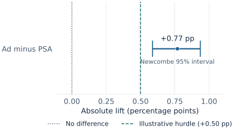

# Marketing A/B Testing

A campaign analyst needs to decide whether the difference in conversion between people shown an ad and people shown a public service announcement (PSA) is large enough to justify an instrumented follow-up. This project estimates that difference using version 1 of Favio Vázquez’s public Kaggle dataset.

The dataset records exposure and a binary purchase indicator. Its metadata describes an ad and PSA experiment, with most users exposed to ads. The released file has one observed exposure group per user and omits the planned allocation, assignment logs, and users with zero logged exposures. See the data card for what assignment and causal claims the release supports. [Dataset](https://www.kaggle.com/datasets/faviovaz/marketing-ab-testing) · [Data card](DATASET.md)

## Results

The observed ad conversion rate was 2.555%. The PSA rate was 1.785%. The difference was +0.769 percentage points (95% Newcombe CI 0.587 to 0.936 pp), or 43.1% relative to the PSA rate.

| Recorded exposure | Users | Conversions | Share | Conversion | Wilson 95% CI |
| --- | ---: | ---: | ---: | ---: | ---: |
| Advertisement | 564,577 | 14,423 | 96.00% | 2.555% | 2.514 to 2.596% |
| Public service announcement | 23,524 | 420 | 4.00% | 1.785% | 1.624 to 1.963% |

The pooled two-sided test gave z = 7.370 and p = 1.71e-13. It tests equal conversion proportions under the independence assumption.

The observed difference corresponds to about 77 more recorded conversions per 10,000 comparable users, with a 95% interval of 59 to 94. The interval clears the illustrative +0.50 pp hurdle. Choose a campaign-specific hurdle before the next test.

The planned group ratio and assignment logs are unavailable. Treat the contrast as an observed difference until the assignment can be verified.



## Reproduce the study

Use Python 3.12. The first run fetches the public Kaggle version 1 ZIP, verifies its CSV against a pinned checksum, and caches it. The documented public download requires no credentials.

```sh
cd projects/marketing-ab-test
python3.12 -m venv .venv
. .venv/bin/activate
python -m pip install -r requirements.txt
python -m src.run
python -m unittest discover -s tests -v
```

For offline use, save the [official version 1 archive](https://www.kaggle.com/api/v1/datasets/download/faviovaz/marketing-ab-testing?datasetVersionNumber=1) at `data/raw/marketing-ab-testing.zip`. The entrypoint also accepts `--raw-dir` and `--reports-dir`. The cache is ignored by Git. Reports contain group aggregates and exclude raw IDs and per-user records.

| Output | Contents |
| --- | --- |
| [metrics.json](reports/metrics.json) | Conversion rates, intervals, difference, relative lift, significance test, and planning scenario |
| [eda.json](reports/eda.json) | Group coverage, data-integrity counts, and descriptive exposure summaries |
| [group-comparison.csv](reports/group-comparison.csv) | Counts, observed group shares, conversion rates, and Wilson intervals |
| [figures/](reports/figures/) | Observed group share, conversion rates, and absolute lift |

To refresh the site after rerunning, copy `reports/figures/*.svg` into `../../docs/assets/marketing-ab-test/` and update the case study’s tables and narrative from the new results. The case study runs from the static `docs/` tree under `/Projects/`.

## Method

1. **Audit observed groups.** Verify the pinned CSV, the two group values, unique user identifiers, conversion type, and blank counts. Report the observed split. A sample-ratio mismatch test requires independently known planned allocation, which the source omits. The file also omits pre-exposure covariates for a balance test.
2. **Compare one primary outcome.** Use the unadjusted difference in conversion proportions, ad minus PSA, with the user as the observation unit. Do not adjust for total exposure or peak exposure day and hour because they follow assignment. Keep the exposure summary descriptive.
3. **Quantify uncertainty.** Use 95% Wilson intervals for each group's proportion, a Newcombe interval based on those Wilson intervals for the absolute difference, and a two-sided pooled two-proportion z test of equal conversion. These methods assume independent observations. The project runs one planned comparison and no segment tests.
4. **Translate the result.** Express the difference in percentage points and per 10,000 comparable users. Compare it with an explicitly illustrative +0.50 percentage-point hurdle. Choose a real hurdle from the campaign’s margins and costs before a prospective test.

## Decision and limitations

Audit the experiment setup before interpreting the conversion contrast as an effect of the ad. Capture planned allocation, assignment and exposure logs, eligible and zero-exposure users, attribution timing, interference risks, and assignment-stage covariates. Use those records to prespecify a primary intention-to-treat analysis and check sample-ratio mismatch.

The published data lack ad spend, purchase values, and margins. A per-user spend limit can be evaluated with incremental conversion probability times contribution margin per purchase, after causal validation. Run a controlled follow-up with reliable assignment records and measure actual campaign costs before making a spend decision.

## Skills demonstrated

Data acquisition and validation, experiment integrity checks, binomial inference, practical effect sizing, reproducible reporting, and accessible static data storytelling.
