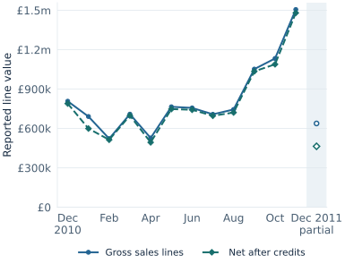

# Online Retail Analytics & Customer Segmentation

An online retailer needs a repeatable way to reconcile recorded sales and credits, compare monthly activity, and choose customer groups for a retention pilot. This project turns the original UCI Online Retail workbook into DuckDB marts for monthly line values, recency–frequency–monetary (RFM) segmentation, and monthly repeat-purchase activity. [UCI Online Retail](https://archive.ics.uci.edu/dataset/352/online+retail) · [Data card](DATASET.md)

## Results

The commercial ledger reconciled £10,563,520.52 in gross paid line value and £490,663.71 in posted credits to £10,072,856.81 in net recorded line value. The extract contains 19,852 distinct paid invoices.

The pipeline classified all 541,909 source lines. It counted 529,765 sale lines and 8,833 credit lines and isolated 3,311 excluded lines. Customer ID was missing on 135,080 source lines. Eligible lines with missing IDs contributed £1,700,940.89 to recorded net value.

November 2011 had the highest net line value of the complete months, at £1,480,295.72. The partial December 2011 figure was £464,172.32 through December 9. Use the complete months for month-to-month comparisons.

The customer snapshot contains 4,293 identified buyers with a qualifying paid invoice. The monetary threshold was the observed net value median, £642.81. The recent high-value repeat segment contained 1,130 customers.

| RFM segment | Customers | Median days since purchase | Median paid invoices | Median net value |
| --- | ---: | ---: | ---: | ---: |
| Recent high-value repeat | 1,130 | 11 | 6 | £2,043.16 |
| Other recent | 531 | 15 | 1 | £344.00 |
| Earlier repeat | 1,358 | 78 | 3 | £849.44 |
| Earlier single-invoice | 1,274 | 174 | 1 | £254.78 |

Among 884 customers first observed in December 2010, 323 made a qualifying purchase in the next month (36.5%). A first observed purchase only anchors the cohort in this file.



## Reproduce the study

Use Python 3.12. The first run downloads the credential-free UCI ZIP, verifies the workbook SHA-256, and caches the archive in the ignored `data/raw` directory.

```sh
cd projects/online-retail
python3.12 -m venv .venv
. .venv/bin/activate
python -m pip install -r requirements.txt
python -m src.run
python -m unittest discover -s tests -v
```

For an offline run, save the [official UCI ZIP](https://archive.ics.uci.edu/static/public/352/online%2Bretail.zip) as `data/raw/online-retail.zip`. Use `--raw-dir` or `--reports-dir` to change the defaults. Only aggregate statistics are written to the reports. To refresh the site, copy the generated SVGs to `../../docs/assets/online-retail/` and update the case-study measurements from the new exports.

| Output | Contents |
| --- | --- |
| [metrics.json](reports/metrics.json) | Provenance, quality and summary totals |
| [monthly.csv](reports/monthly.csv) | Monthly paid invoice counts, sales, credits and net line value |
| [segments.csv](reports/segments.csv) | Customer segment counts and aggregate RFM values |
| [cohorts.csv](reports/cohorts.csv) | First-observed cohorts and later month purchase activity |
| [quality.csv](reports/quality.csv) | Row-level classification counts with no raw rows |
| [figures/](reports/figures/) | Three generated dashboard charts |

## Transformation flow

```text
UCI ZIP → pinned workbook → normalized invoice lines
        → classified ledger → invoice and monthly marts
                             → identified paid invoices → RFM segments
                                                        → repeat-purchase cohorts
```

1. **Normalize the workbook.** Validate the original schema, preserve nullable customer IDs, normalize invoice keys, and retain every source row. Record identical repeats because the source lacks a line identifier needed to distinguish duplicates from legitimate repeated entries.
2. **Classify posted values.** Treat a non-cancellation line with positive quantity and price as a paid sale. Treat a cancellation invoice with negative quantity and positive unit price as a posted credit. Keep anomalies, zero-price lines, and selected administrative codes in quality counts. The data card lists the explicit exclusions. Compute paid sales, credit magnitude, and net recorded value in pounds. Credit posting dates can differ from the sale dates.
3. **Keep accounting coverage.** Include eligible anonymous invoice lines in the monthly ledger. Use invoices with a customer ID when calculating customer-level measures. December 2011 has nine observed days, so its reported records are marked partial.
4. **Build customer views through November 30, 2011.** Measure days since last paid invoice, distinct paid invoice count, and net GBP for identified customers with paid purchases. Use transparent recency, repeat-purchase, and median-value thresholds to form segments. Build cohorts by first observed paid month and count repeat purchase activity during complete later months. Cohort membership starts at the first purchase visible in this workbook.

## Interpretation

Use the reconciled values for operational reporting and review how credit volumes affect monthly comparisons. Accounting reconciliation would require checking the retailer’s actual ledger, costs, taxes, and adjustments. The data lack direct links from every credit to its original paid invoice.

Use the segments to plan a limited follow-up with eligible customers and an appropriate comparison group. The selected date and segment thresholds describe this historical workbook. Customer-ID coverage can change the mix of customers in the analysis. A gap in observed purchasing has several possible explanations, including purchases outside the observation window. The cohort chart measures recorded activity by month.

## Skills demonstrated

Workbook integrity, DuckDB transformations, month-over-month reconciliation, customer segmentation, cohort analysis, fixture tests, and static reporting.
