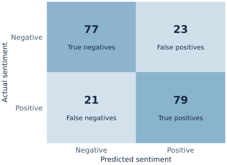

# Restaurant Review Sentiment Classification

A restaurant feedback analyst wants a way to route clearly positive and negative review sentences for human review. This project measures how well a lightweight TF-IDF classifier reproduces the published labels on the Yelp subset of UCI Sentiment Labelled Sentences. The primary selection metric is macro F1, which gives both labels equal weight. [Dataset and license](https://archive.ics.uci.edu/dataset/331/sentiment+labelled+sentences) · [Data card](DATASET.md)

## Results

The validation-selected unigram classifier achieved 0.780 holdout macro F1, compared with 0.333 for the prior-only dummy. It correctly labeled 156 of 200 holdout sentences (78.0%).

The split had 597 training, 199 validation, and 200 holdout sentences.

| Model | Validation macro F1 | Holdout macro F1 | Accuracy | Average precision |
| --- | ---: | ---: | ---: | ---: |
| Prior-only dummy | 0.334 | 0.333 | 50.0% | 0.500 |
| TF-IDF unigrams (selected) | 0.799 | 0.780 | 78.0% | 0.843 |
| TF-IDF unigrams + bigrams | 0.794 | 0.755 | 75.5% | 0.858 |

| Label | Precision | Recall | F1 | Sentences |
| --- | ---: | ---: | ---: | ---: |
| Negative | 0.786 | 0.770 | 0.778 | 100 |
| Positive | 0.775 | 0.790 | 0.782 | 100 |

The holdout produced 23 false positives and 21 false negatives. The error report contains short attributed samples. Some of the misclassified text mixes praise with criticism or expresses a favorable judgment indirectly. [Error examples](reports/error-examples.json)



## Reproduce the study

Use Python 3.12 from a repository checkout. The first run downloads UCI’s official public ZIP, verifies the Yelp member against a pinned checksum, and caches the archive in the ignored `data/raw/` directory.

```sh
cd projects/restaurant-sentiment
python3.12 -m venv .venv
. .venv/bin/activate
python -m pip install -r requirements.txt
python -m src.run
python -m unittest discover -s tests -v
```

For an offline run, save the [official UCI archive](https://archive.ics.uci.edu/static/public/331/sentiment%2Blabelled%2Bsentences.zip) as `data/raw/sentiment-labelled-sentences.zip`. The command also accepts `--raw-dir` and `--reports-dir`. To refresh the portfolio, copy `reports/figures/*.svg` into `../../docs/assets/restaurant-sentiment/` and update the case-study numbers from the reports.

| Output | Contents |
| --- | --- |
| [metrics.json](reports/metrics.json) | Source provenance, split composition, model and per-class metrics, and confusion counts |
| [eda.json](reports/eda.json) | Training review-length summaries and quality counts |
| [model-comparison.csv](reports/model-comparison.csv) | Validation and test macro F1, accuracy, and average precision |
| [error-examples.json](reports/error-examples.json) | Brief attributed Yelp excerpts for error analysis |
| [figures/](reports/figures/) | Holdout comparison, selected confusion matrix, and class metrics |

## Method

1. **Validate and deduplicate the Yelp file.** Parse one sentence and one 0/1 label per row. Build comparison keys with Unicode NFKC, collapsed whitespace, and case folding. Keep the first source sentence for each shared key. This removes four repeats and keeps the same text out of multiple splits.
2. **Split before learning the vocabulary.** Use seeded stratified training, validation, and test partitions at approximately 60%, 20%, and 20%. TF-IDF tokenization and inverse document frequency are fit within the training pipeline.
3. **Compare candidates on the same rows.** Fit a prior-only dummy, logistic regression with unigram TF-IDF, and logistic regression with unigram and bigram TF-IDF. Select by validation macro F1. Evaluate all three on the holdout, and review per-class precision, recall, F1, and confusion counts for the selected model.
4. **Inspect actual errors.** Review examples where the model score was furthest from the predicted class boundary on the wrong side. Report small attributed text excerpts. These examples illustrate failure cases and support manual follow-up.

## Limits and decision use

The Yelp subset consists of short curated sentences with positive and negative annotations. It omits a neutral label and full review context. The score measures agreement with those annotations in this sample. Mixed feedback, negation, sarcasm, and reviews that depend on preceding sentences can produce errors.

Use the model to prioritize a human review queue after validating it on current restaurant feedback. Check longer reviews, ambiguous labels, and a sample across representative locations and time periods. Include a way to leave uncertain cases for manual review. The release gives a benchmark for this classification task, and operational use needs a separate evaluation of the intended queue.

## Skills demonstrated

Text validation, normalized deduplication, seeded stratified evaluation, train-only TF-IDF, classification diagnostics, and accessible static reporting.
