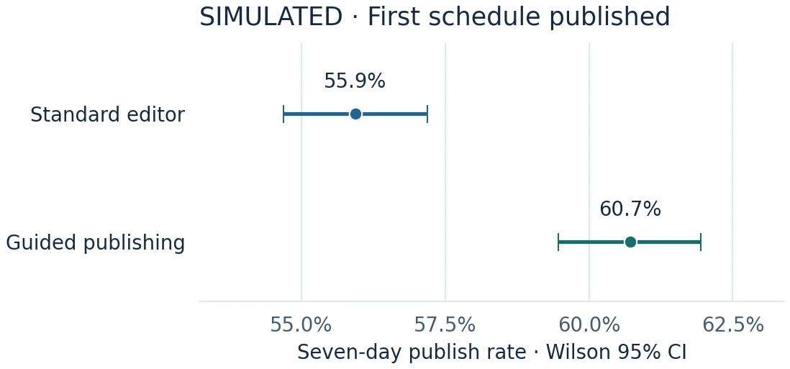
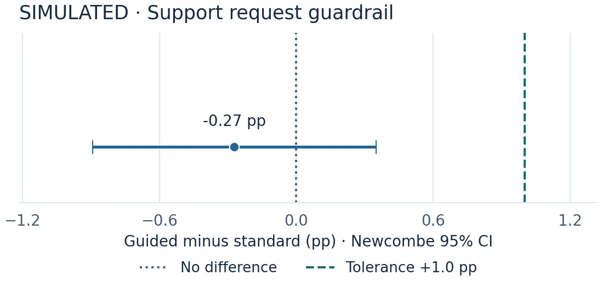

# Scheduling A/B Test

This synthetic experiment illustrates how a product team could test whether a guided checklist helps managers publish their first schedule within seven days. The control uses a standard editor. The variant adds guidance through the publishing steps. Each of the 12,000 simulated workspaces has one eligible manager, and each workspace is independently assigned with a 50% chance of receiving the guided flow. [Data card](DATASET.md) · [Case study source](../../docs/case-studies/scheduling-ab-test.html)

The generator assumes a 55% publishing rate for control and 60% for guided, a planted lift of 5 percentage points (pp). It also assumes that support request rates rise from 3.0% to 3.2%, a planted increase of 0.2 pp. The simulated sample estimates vary around these inputs.

## Simulated results

The primary outcome is first schedule publish within seven days. The support guardrail is any support request during the same window. Both rates use every assigned workspace as the denominator.

| Assigned experience | Workspaces | Published | Publish Wilson 95% CI | Requested support | Support Wilson 95% CI |
| --- | ---: | ---: | ---: | ---: | ---: |
| Standard editor | 6,028 | 3,372 (55.94%) | 54.68% to 57.19% | 194 (3.22%) | 2.80% to 3.69% |
| Guided flow | 5,972 | 3,626 (60.72%) | 59.47% to 61.95% | 176 (2.95%) | 2.55% to 3.41% |

Publishing increased by **4.78 pp** in the simulated sample (95% Newcombe interval +3.01 to +6.54 pp), an 8.54% relative lift. The pooled z test returned p = 1.11 × 10⁻⁷. The allocation check returned χ² = 0.261 and p = 0.609, above the prespecified flag threshold of 0.01.

Support requests changed by **−0.27 pp** (95% Newcombe interval −0.89 to +0.35 pp). This interval includes zero and the planted +0.20 pp increase. Its upper bound is below the +1 pp tolerance, and the publishing interval’s lower bound exceeds the +2 pp practical hurdle. The sample passes the simulation’s decision rule.





## Reproduce the simulation

Run from the repository root with Python 3.12. The entrypoint generates the simulated records in memory and writes aggregate reports and charts. The generator uses Python’s standard-library random number generator and a fixed seed.

```sh
cd projects/scheduling-ab-test
python3.12 -m venv .venv
. .venv/bin/activate
python -m pip install -r requirements.txt
python -m src.run
python -m unittest discover -s tests -v
```

Use `--seed`, `--workspaces`, and `--output-dir` to run another simulation or write to a separate directory. The reported run uses seed 42 and 12,000 workspaces.

| Output | Contents |
| --- | --- |
| [metrics.json](reports/metrics.json) | Assignment counts and sample-ratio check, per-arm outcomes, uncertainty intervals, and decision rule |
| [publish-rate.webp](reports/figures/publish-rate.webp) | Simulated publishing rates and Wilson intervals |
| [support-guardrail.webp](reports/figures/support-guardrail.webp) | Simulated support request difference, its interval, and the +1 pp limit |

## Design and analysis

1. **Set the unit and assignment rule.** The workspace is the unit of randomization and analysis. A fixed 12,000-workspace sample illustrates the workflow. A live experiment would size its sample using expected baseline rates, the effect worth detecting, and the desired power.
2. **Check assignment.** Compare the realized allocation with the expected 50/50 split using a Pearson chi-squared sample-ratio mismatch test. Flag p < 0.01. Bernoulli assignment permits chance differences in counts. A live allocation audit would also verify eligibility, assignment logging, and complete outcome capture.
3. **Estimate the intention-to-treat difference.** Compare guided minus control by original assignment, including workspaces without any recorded event. Use Wilson 95% intervals for each arm and a Newcombe 95% interval for the difference. A two-sided pooled proportion z test on publishing checks the null of equal rates.
4. **Check practical value and support risk.** The demonstration requires the lower bound of the publishing interval to exceed +2 pp and the upper bound of the support request interval to be below +1 pp. It also requires the allocation check to pass. These thresholds were chosen for the simulated decision rule.

## Interpretation and limitations

The results show how the analysis behaves when the generator includes a known effect. The simulation assumes complete outcome capture, independent workspaces, and independent publish and support draws conditional on assignment. A live product could have shared managers, incomplete follow-up, or correlated events. Define eligibility and the outcome window in advance, verify assignment and event instrumentation, and account for interference and dependence when designing a real study. Use actual support capacity and product priorities to set the decision thresholds.
