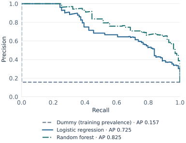

# Telecom Churn & Retention Modeling

A telecom retention team has a limited support and outreach capacity. This study asks whether usage, tenure, and service information from the first nine months can rank customers by churn risk at month 12. The three-month planning gap is part of the dataset design. Average precision measures ranking with a minority churn class. Precision and recall show which observed cases a proposed contact list would cover at a given budget.

The analysis uses the original **UCI Iranian Churn** dataset (ID 563), with 3,150 rows and 495 churn labels from one historical telecom company. The study examines telecom customer retention. Its source, license, schema, and scoring-time assumptions are documented in the data card. [Data card](DATASET.md) · [UCI Iranian Churn](https://archive.ics.uci.edu/dataset/563/iranian+churn+dataset)

## Results

The validation-selected random forest reached holdout average precision of 0.825, compared with 0.157 for the prior-only baseline. The top 20% of holdout scores flagged 84 of 99 observed churners, compared with about 20 expected under random selection of the same 126 records.

| Model | Validation AP | Holdout AP | Holdout ROC-AUC | Holdout Brier |
| --- | ---: | ---: | ---: | ---: |
| Prior-only dummy | 0.156 | 0.157 | 0.500 | 0.132 |
| Logistic regression | 0.778 | 0.725 | 0.922 | 0.075 |
| Random forest (selected) | 0.884 | 0.825 | 0.962 | 0.059 |

The grouped partitions contained 1,892 training rows, 627 validation rows, 631 holdout rows. In training, 125 of 149 records with a complaint churned (83.9%). For records without a complaint, the rate was 9.9% (173 of 1,743). Verify complaint timestamps and exclude cancellation requests before using that signal in a pilot.



The frozen rule (score > 0.223746, rounded) flagged 125 validation records (19.94%) and 163 holdout records (25.83%). That exceeded the intended 20% outreach capacity on the holdout. It flagged 93 observed churners and 70 nonchurners, and missed 6 churners. At that cutoff, holdout precision was 57.06%, recall was 93.94%, and F1 was 0.710. [Confusion matrix](reports/figures/confusion-matrix.svg)

| Budget | Flagged | Observed churners | Expected random | Precision | Recall |
| --- | ---: | ---: | ---: | ---: | ---: |
| 10% | 63 | 52 | 10 | 82.54% | 52.53% |
| 20% | 126 | 84 | 20 | 66.67% | 84.85% |
| 30% | 189 | 96 | 30 | 50.79% | 96.97% |

A ranked batch capped at 20% flagged 84.85% of observed churners on the holdout. The results support checking a volume-capped pilot on newer customers. A randomized comparison is needed to estimate how many customers stay because of outreach. [Budget chart](reports/figures/retention-budget.svg)

## Reproduce the study

Use Python 3.12 from a checkout of this repository. The first run downloads the official UCI ZIP, verifies its CSV against a pinned checksum, and writes the validated archive to an ignored cache.

```sh
cd projects/telecom-churn
python3.12 -m venv .venv
. .venv/bin/activate
python -m pip install -r requirements.txt
python -m src.run
python -m unittest discover -s tests -v
```

For an offline run, download the [official ZIP](https://archive.ics.uci.edu/static/public/563/iranian%2Bchurn%2Bdataset.zip) to `data/raw/iranian-churn.zip` first. The entrypoint also accepts `--raw-dir` and `--reports-dir`. It writes summary statistics and model results. Raw records and per-customer scores are excluded from repository artifacts.

| Output | Contents |
| --- | --- |
| [metrics.json](reports/metrics.json) | Source provenance, split group counts, model metrics, reliability bins, and contact scenarios |
| [eda.json](reports/eda.json) | Schema checks, duplicates and grouping counts, and training-only complaint and usage summaries |
| [model-comparison.csv](reports/model-comparison.csv) | Validation and holdout model scores at the common 0.50 cutoff |
| [figures/](reports/figures/) | Generated split, complaint, precision–recall, confusion-matrix, and budget charts |

To refresh the site after rerunning, copy `reports/figures/*.svg` into `../../docs/assets/telecom-churn/` and update the case-study tables and narrative from the reports. Serve the static `docs/` directory under `/Projects/` for local site review.

## Method

1. **Acquire and audit the file.** Verify the original archive and schema, normalize column spelling, and validate numeric and categorical codes. Preserve the 3,150 source rows. The file has 300 repeated full rows after their first occurrence and omits customer IDs needed to distinguish repeated records from distinct customers with matching fields.
2. **Define information available during the observation window.** Include recorded complaints, service usage, tenure, charge level, and tariff type. Derive average voice-call seconds when call frequency is positive and mark rows with zero voice-call frequency. Exclude `Status` because inactive service is closely related to churn and its snapshot definition is limited. Exclude `Customer Value` because its inputs and timestamp are unspecified. Omit both age fields to limit demographic targeting.
3. **Keep identical input profiles together.** Use stratified group five-fold splitting, seed 42, with all rows sharing an exact eligible predictor vector in one fold. Use fold 0 for holdout, fold 1 for validation, and folds 2–4 for training. The CSV has one observation window and no cohort dates. The grouped evaluation prevents identical profile overlap and measures performance within this sample.
4. **Fit on training and select on validation.** Use training-fitted imputation, scaling, and encoding in pipelines for a prior-only dummy classifier, logistic regression, and random forest. Select the model by validation average precision (the non-interpolated precision–recall summary). Measure holdout AP, ROC-AUC, Brier score, calibration bins, confusion counts, precision, recall, and F1.
5. **Compare retention contact rules.** Choose a strict validation cutoff to stay within 20% contact capacity, and evaluate its selections on the holdout. Separately evaluate the top-ranked 10%, 20%, and 30% of holdout rows with a stable source-row tie-breaker. The expected random count is the number selected times holdout churn prevalence.

## Limits and decision use

This is a within-sample result from one telecom company. Identical-input grouping prevents an exact profile from appearing in multiple splits. The missing customer identifiers and dates limit audits of near duplicates, genuinely disjoint customer cohorts, and drift. The label records churn in a historical observation process. Applying the scores elsewhere would require checking current feature definitions, consent, and population performance on a newer cohort.

Use the scores to prioritize a capacity-capped retention pilot among eligible customers, with an appropriate randomized comparison. Track incremental retention, opt-outs, support capacity, and contact costs. The data describe who churned under the observed process. Estimating whether outreach prevents churn requires a pilot with a comparison group.

Check contact coverage and error rates across relevant segments where lawful and feasible. Service and usage behavior can proxy for demographic, regional, or economic factors even with age excluded. Treat low usage and complaints as signals to investigate, and keep staff discretion over any customer outreach. [Data card](DATASET.md)

## Skills demonstrated

Source validation, leakage auditing, grouped stratified evaluation, train-fitted feature processing, imbalanced classification, retention budget analysis, reproducible reporting, and static portfolio integration.
